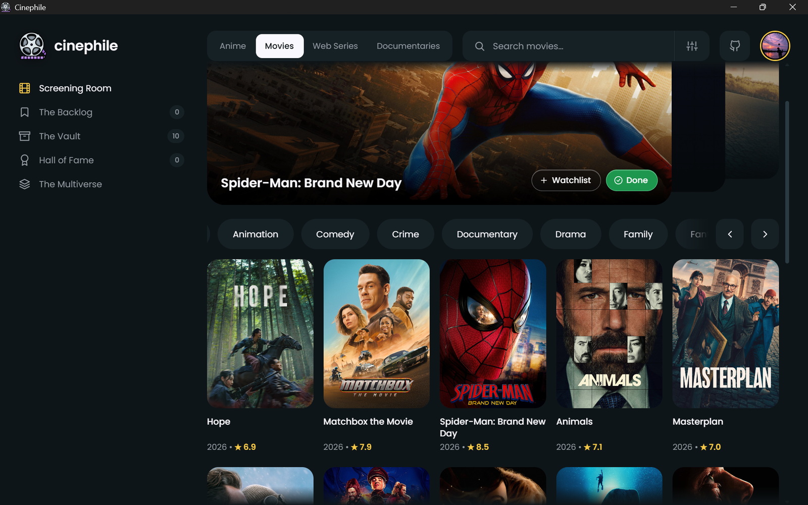
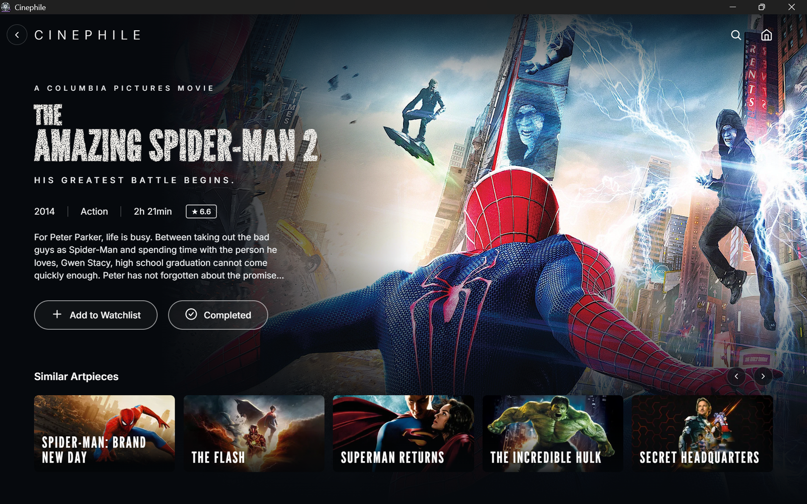
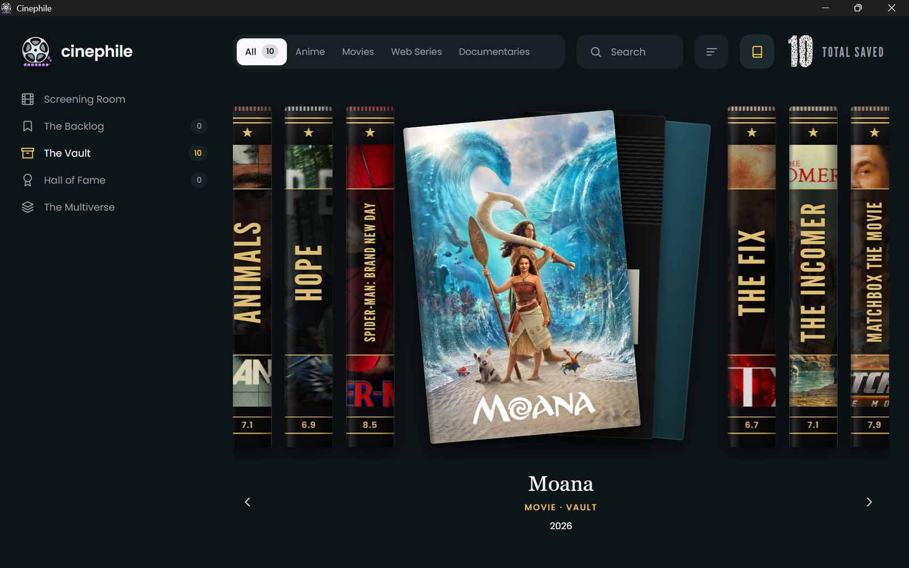
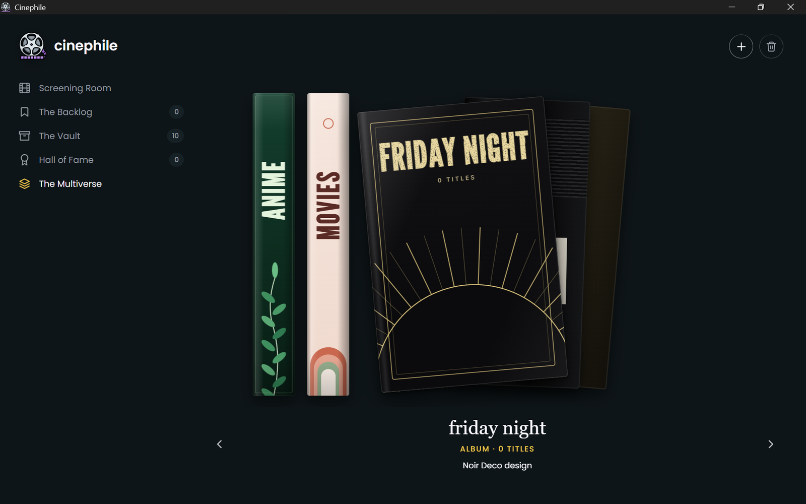

# Cinephile

Cinephile is a desktop app (Electron, Windows) for browsing and keeping track of movies, web series, anime and documentaries. Titles, posters and details come from [TMDB](https://www.themoviedb.org/); your own lists, albums and settings are kept on your computer.



| Movie page | The Vault as a shelf of books |
| --- | --- |
|  |  |



## Features

- Browse trending titles and genres in four categories: Anime, Movies, Web Series and Documentaries, with a hero carousel and infinite-scrolling poster grid.
- Search TMDB within a category.
- Movie / series page with description, rating, runtime and similar titles.
- **The Backlog** (watchlist), **The Vault** (completed) and **Hall of Fame**, each filterable by category, sortable by rating and searchable.
- A link button on the category toggle keeps the Backlog, Vault and Hall of Fame on the same category.
- Book view: show any of those pages as a shelf of book spines built from the posters.
- **The Multiverse**: create and delete your own albums (eight cover designs) and fill them with titles.
- Optional profile photo.

An internet connection is needed to browse, search and load posters (they come from TMDB). Titles you already saved are listed offline, but their posters are still downloaded when shown.

## Install on Windows

1. Open the **Releases** page of this repository: `https://github.com/<your-username>/<your-repo>/releases` (replace with the real address once published).
2. Download `Cinephile-Setup-<version>.exe` from the latest release.
3. Run it and follow the wizard (you can choose the install folder).
4. Start **Cinephile** from the Start Menu or the desktop shortcut.

You do not need Node.js, npm or Git to use the installer. The installer is not code-signed, so Windows SmartScreen may warn you; see [docs/installation.md](docs/installation.md).

## First run: add your TMDB key

Cinephile needs a free TMDB API key. On first launch a window asks for it; you can reopen it later with the key button at the top right. Step by step: [docs/api-configuration.md](docs/api-configuration.md). No file editing is needed.

## Develop from source

Requires Node.js 22.12 or newer (LTS) and npm.

```
git clone https://github.com/<your-username>/<your-repo>.git
cd <your-repo>
npm ci
npm start
```

## Build the Windows installer

```
npm ci
npm run dist:win
```

The installer is written to `dist/Cinephile-Setup-<version>.exe`. Details, release steps and troubleshooting: [docs/building.md](docs/building.md) and [docs/troubleshooting.md](docs/troubleshooting.md).

## Technology

Electron 44, plain HTML / CSS / JavaScript (no framework), TMDB API, fonts from Fontsource (Poppins, Inter, League Gothic), electron-builder with an NSIS installer.

## Privacy and your data

- Your lists, Hall of Fame, albums, profile photo, view preferences and TMDB key are stored locally with the app (Chromium local storage inside `%APPDATA%\cinephile`). Nothing is sent to a Cinephile server; there is none, and the app has no analytics.
- The app contacts only TMDB (`api.themoviedb.org` for data, `image.tmdb.org` for images). TMDB receives the requests the app makes, including your key and IP address, under [TMDB's own terms](https://www.themoviedb.org/privacy-policy).
- Data stays across restarts. The installer is configured not to remove that folder when you update or uninstall, but backing it up is your responsibility. See [docs/installation.md](docs/installation.md).
- The key is kept in local storage, which is **not** a secure vault. Use a key you can revoke.

## TMDB attribution

This product uses the TMDB API but is not endorsed or certified by TMDB.

## Contributing, security, license

- [CONTRIBUTING.md](CONTRIBUTING.md), [CODE_OF_CONDUCT.md](CODE_OF_CONDUCT.md), [SECURITY.md](SECURITY.md)
- Released under the [MIT License](LICENSE).
